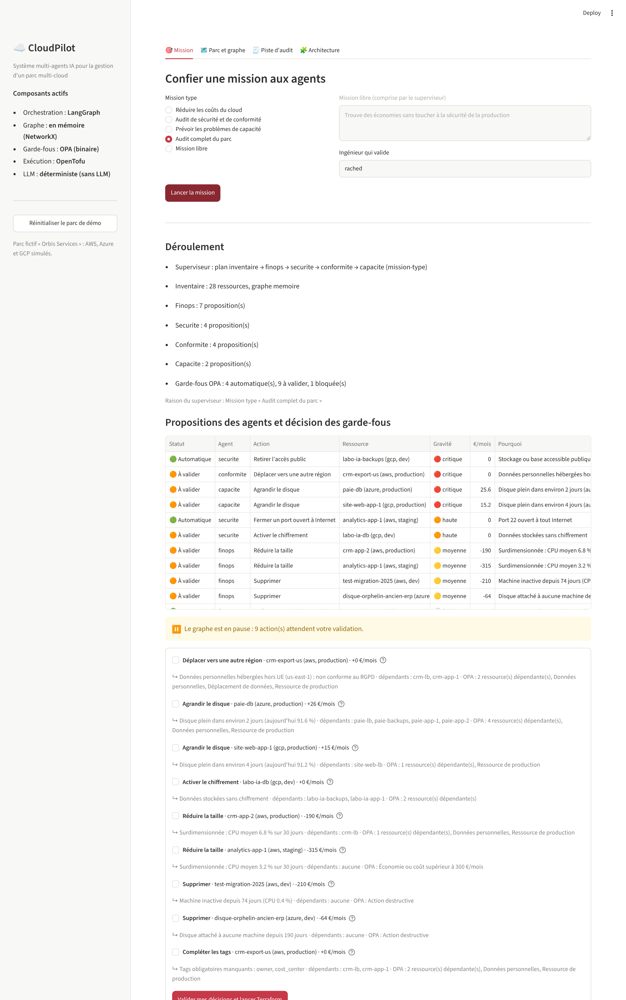
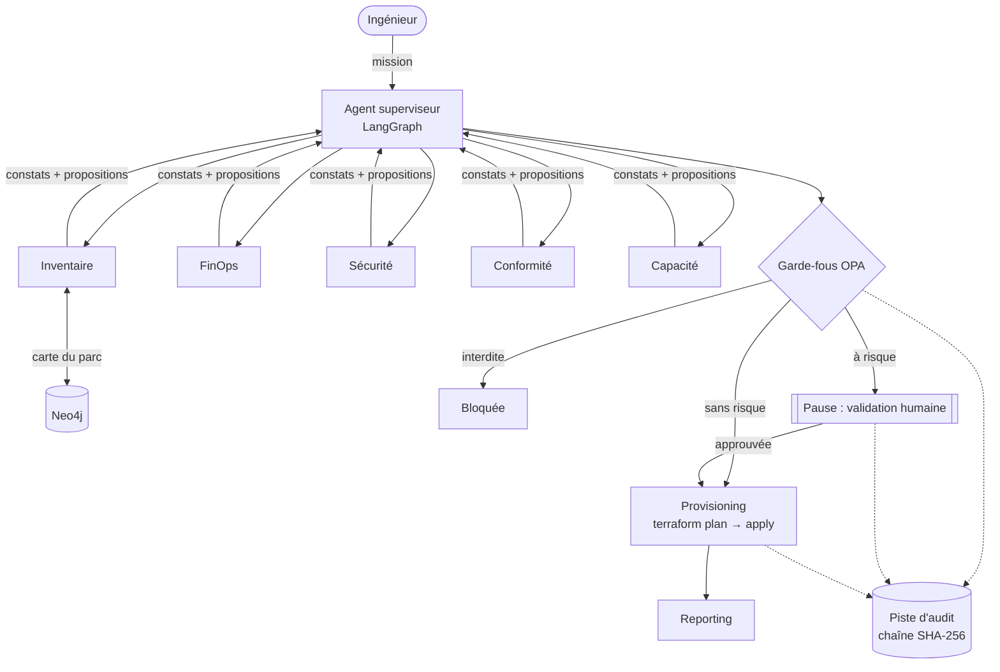
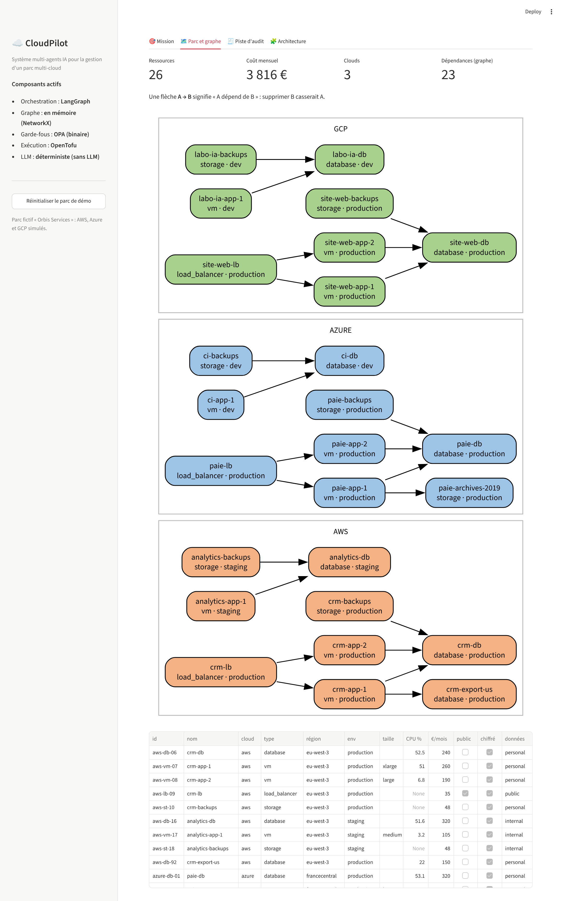
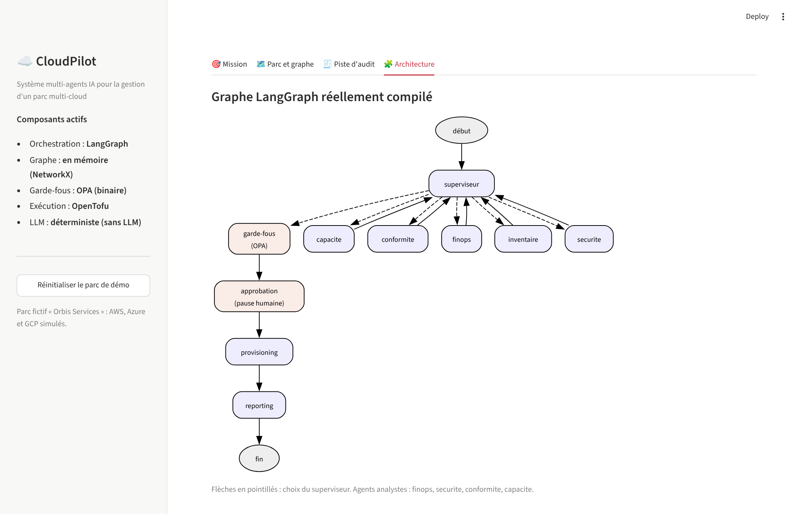
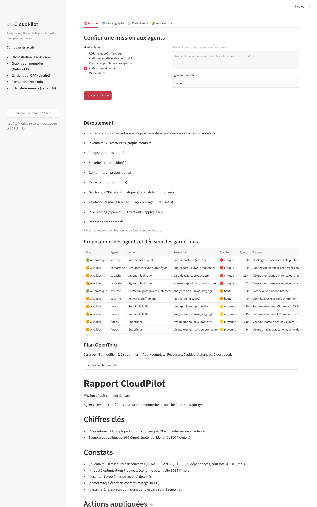
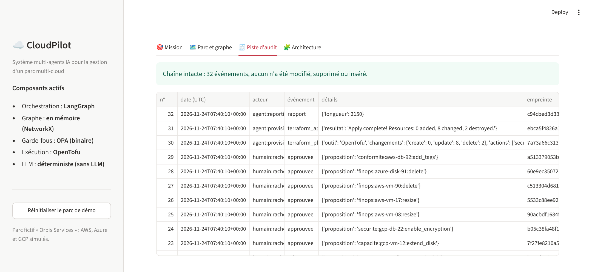

# ☁️ CloudPilot — Système multi-agents IA pour la gestion d'un parc multi-cloud


CloudPilot est une **équipe d'agents IA** qui découvre, analyse et optimise en continu un parc
**multi-cloud** (AWS, Azure, GCP).

- **Agents spécialisés :** sept agents spécialisés travaillent sous la coordination d'un **agent superviseur** (LangGraph).
- **Carte du parc :** le parc et ses dépendances sont modélisés dans **Neo4j**.
- **Garde-fous :** chaque action proposée passe par des garde-fous **OPA**.
- **Validation humaine :** les actions à risque attendent la **validation d'un ingénieur**.
- **Exécution :** les changements sont appliqués avec **Terraform** (`plan`, puis `apply`).
- **Audit :** chaque décision est inscrite dans une **piste d'audit infalsifiable**.



## Le principe



| Agent | Rôle | Exemple dans le parc de démo |
|---|---|---|
| **Superviseur** | Comprend la mission et choisit les agents (LLM ou règles) | « Réduis nos coûts » → inventaire, FinOps |
| **Inventaire** | Interroge les 3 clouds et met à jour le graphe Neo4j | 28 ressources, 23 dépendances, 4 800 €/mois |
| **FinOps** | Ressources surdimensionnées, oubliées, allumées la nuit | VM à 3 % de CPU, disque orphelin depuis 190 jours |
| **Sécurité** | Accès publics, ports ouverts à Internet, chiffrement | Sauvegardes publiques, SSH ouvert à 0.0.0.0/0 |
| **Conformité** | Tags obligatoires, RGPD | Données personnelles hébergées aux États-Unis |
| **Capacité** | Prévision par régression linéaire | Disque de la paie plein dans environ 2 jours |
| **Provisioning** | Applique les actions validées avec Terraform | `Plan: 0 to add, 8 to change, 2 to destroy` |
| **Reporting** | Rapport chiffré, synthèse rédigée par le LLM | Économies appliquées et actions bloquées |

## Les garde-fous, au cœur du projet

Un agent IA **ne peut pas** agir seul sur une ressource sensible. Chaque proposition est évaluée
par **OPA** ([`policies/cloudpilot.rego`](policies/cloudpilot.rego)), avec l'impact calculé dans Neo4j
(qui dépend de cette ressource ?).

| Résultat OPA | Exemples de règles | Effet |
|---|---|---|
| 🔴 **Interdite** | Supprimer en production ; supprimer une ressource dont d'autres dépendent ; sortir des données personnelles de l'UE | Bloquée, même un humain ne peut pas la forcer |
| 🟠 **À valider** | Production, action destructive, données personnelles, économie > 300 €/mois | Le graphe LangGraph se met **en pause** (`interrupt`) |
| 🟢 **Automatique** | Arrêt la nuit d'une VM de dev, fermeture d'un port, ajout de tags | Appliquée directement |

**La pause est durable.** L'état du graphe est sauvegardé (checkpoint SQLite) : l'ingénieur peut
valider plus tard, même après un redémarrage de l'application.

## Lancer le projet (Windows)

Prérequis : **Python 3.10+**.

```cmd
git clone https://github.com/Rached12364/CloudPilot.git
cd CloudPilot
python -m pip install -r requirements.txt
python -m streamlit run app.py
```

Le projet fonctionne **tout de suite**, même sans les outils externes : l'interface affiche dans la
barre latérale quel composant est réellement actif. Pour activer chacun d'eux :

| Composant | Installation | Sans lui |
|---|---|---|
| **OPA** | `curl -L -o tools\opa.exe https://openpolicyagent.org/downloads/v0.68.0/opa_windows_amd64.exe` | Règles de secours en Python (mêmes résultats, vérifiés par les tests) |
| **Terraform** | `winget install Hashicorp.Terraform` | Plan calculé par CloudPilot |
| **Neo4j** | `docker compose up -d neo4j` puis `set NEO4J_URI=bolt://localhost:7687` et `set NEO4J_PASSWORD=cloudpilot-demo` | Graphe en mémoire (NetworkX) |
| **LLM (Ollama)** | `ollama pull llama3.2:3b` | Superviseur par mots-clés, rapport sans synthèse |

En ligne de commande : `python cli.py "Réduis nos coûts AWS"`.

Tests : `python -m pytest -q`, et `opa test policies` pour les règles Rego.

## Captures

| Parc et graphe des dépendances | Graphe LangGraph compilé |
|---|---|
|  |  |
| **Rapport et plan Terraform** | **Piste d'audit vérifiable** |
|  |  |

## Ce que vérifient les tests

- Chaque agent trouve exactement les situations préparées dans le parc de démo.
- **Scénario complet :** une proposition est bloquée par OPA, une autre est refusée par l'humain, une approuvée est appliquée. Le test vérifie ensuite l'état final du parc et la piste d'audit.
- **Reprise d'une pause** de validation après un redémarrage (checkpoint SQLite).
- **Plan Terraform réel :** 2 suppressions détectées et `apply` exécuté.
- **Règles OPA :** 6 tests Rego, et le moteur de secours donne les mêmes décisions qu'OPA sur 75 cas.
- **Neo4j réel :** il renvoie les mêmes dépendances que le graphe en mémoire.
- **Falsification de l'audit :** une ligne modifiée ou supprimée est détectée.
- **LLM superviseur :** un agent inventé par le LLM est ignoré.

## Limites (démo honnête)

- **Le parc est simulé.** Les connecteurs lisent un fichier d'état. En production, on les remplacerait par boto3, le SDK Azure et le SDK Google Cloud, et `terraform_data` par `aws_instance`, `azurerm_*`, `google_*`.
- **Le LLM ne fait pas les calculs.** Les constats viennent de règles explicites et testées. Le LLM pilote (choix des agents) et rédige (synthèse). C'est un choix volontaire : on ne laisse pas un LLM décider seul d'une suppression.
- **Pas d'authentification sur l'interface.** C'est une démo locale. En production, on ajouterait SSO et rôles, et la piste d'audit serait stockée dans une base en écriture seule.

## Auteur

**Rached ILAHI**, élève ingénieur en génie informatique, ENICarthage
[GitHub](https://github.com/Rached12364) · [Portfolio](https://rached12364.github.io)
